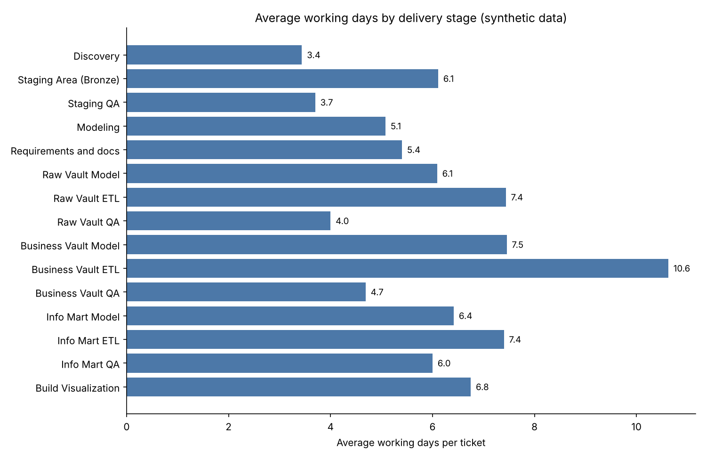

# Velocity Analytics (prototype)

A small Python engine that answers: **how many working days does each delivery stage really take, per team?**

It reads the status history of tickets (when each one moved to "In Progress" and to "Done"), works out
the business days between them, labels every ticket with a delivery stage from its title and the role of
the person who worked on it, and averages the days per stage and per team.

- **Business days, not calendar days.** Weekends and US federal holidays are skipped (or weekends only, your choice).
- **Stage labelling from simple rules.** Keywords in the ticket title plus the assignee role decide the stage. The rules are plain tables you can edit.
- **Outliers are left out.** Tickets that took more than 20 working days (configurable) do not count.
- **Agent tools.** `velocity_analytics.tools` has plain functions for an LLM agent, so the model never does the arithmetic.

> This is a prototype on **synthetic data**. Everything here belongs to a fictional company,
> "Larkspur Synthetic Group". No real organisation, product, system or person is used.



## Quick start

```bash
pip install -e ".[dev]"          # python 3.10+, pandas 2 or 3
pytest -q                        # 34 tests, including a golden file regression test
velocity-run                     # runs on data/synthetic and writes output/velocity_output.xlsx
python demo/make_chart.py         # the chart above
```

As a library:

```python
from velocity_analytics import Config, load_history, load_lookups, run_velocity

result = run_velocity(
    load_history("data/synthetic/issue_history.csv"),
    load_lookups("data/synthetic/lookup_tables.xlsx"),
    Config(max_working_days=20, holiday_calendar="us_federal"),
)
result.average_velocity      # one row per stage, columns Overall + one per team
result.refined               # the tickets that count towards the averages
result.worksheet             # every ticket with all the intermediate columns
```

## Tools for an agent

```python
from velocity_analytics import tools

tools.stage_velocity(result, "Raw Vault ETL", team="Finance Pod")
# {"stage": "Raw Vault ETL", "team": "Finance Pod", "avg_working_days": 5.5, "tickets": 6}

tools.slowest_stages(result, n=3)
# [{"stage": "Business Vault ETL", "main_stage": "Business Vault", "avg_working_days": 10.62}, ...]
```

Bad stage or team names raise a `ValueError` that lists the valid choices, so an agent can correct itself.

## Input data

There is no live connection to any ticket tool. You give the engine two files.

**`issue_history.csv`** (or `.xlsx`): one row per status change of a ticket.

| Column | Needed | Meaning |
|---|---|---|
| `Key` | yes | ticket id |
| `Summary` | yes | ticket title (used to find the stage) |
| `ActivityDate` | yes | when the status changed |
| `To` | yes | the new status, the engine looks for `In Progress` and `Done` |
| `Team` | yes | team of the ticket |
| `Assignee` | yes | person, matched to the roles table |
| `Epic Key`, `Story Points`, `From`, `Current Status`, `Issue Created Time` | no | carried through when present |

Most ticket tools can export this change log. A ticket that was never moved to `In Progress` is ignored.
A ticket that has not reached `Done` has no working days and does not count.

**`lookup_tables.xlsx`**: seven sheets (`roles`, `keywords`, `stages`, `keywords2`, `mainstage_role`,
`mapping`, `summary_sequence`) that turn a title and a role into a stage. See [docs/logic.md](docs/logic.md).

The synthetic files in `data/synthetic/` are built by `scripts/generate_synthetic_data.py` (seeded).

## Output

`velocity-run` writes one workbook with three sheets: `average_velocity`, `worksheet_refined`, `worksheet`.

## Use it with roadmap-engine

The sister repository `roadmap-engine` (same author) schedules pods using
default durations (`source_days`, `domain_days` and so on). The averages from this project are a
data based way to choose those numbers: measure first, then plan. The link is manual for now, there is
no code dependency between the two.

## Repository layout

```
src/velocity_analytics/
  workdays.py    business day counting
  worksheet.py   status history to one row per ticket
  stages.py      keywords and roles to delivery stage
  velocity.py    outlier rule and averages
  engine.py      run_velocity(): the whole pipeline
  io.py          read inputs, write the output workbook
  tools.py       agent facing functions
  cli.py         velocity-run
demo/make_chart.py                    chart (headless)
scripts/generate_synthetic_data.py    seeded data generator
scripts/check_scrub.py                pre-publish checks
tests/                                unit tests and a golden regression test
```

## How it is tested

`tests/golden/golden_output.xlsx` was produced by running the original single script version of this
prototype on the synthetic data (with its ticket fetching replaced by the synthetic history). The test
checks that the packaged engine reproduces all three result tables value by value. Other tests cover
the business day rule, reopened tickets, the stage rules and the agent tools.

## Limits (it is a prototype)

- Keyword matching is a plain lower case substring match, first keyword in table order wins. A short keyword such as `bi` also matches inside longer words.
- Working days are counted from the last move to `In Progress` to the last move to `Done`. Time spent blocked or waiting is included.
- A person listed with two roles in the roles table produces one row per role for each of their tickets.
- The holiday calendar is US federal holidays only. Use `holiday_calendar="weekdays"` for weekends only.
- It is descriptive statistics (plain averages), not a forecast.

## License

[PolyForm Noncommercial 1.0.0](LICENSE). Copyright (c) 2026 Jaishri Rai.
You may use, modify and share the code for noncommercial purposes. Commercial use needs
the author's permission.
